# MicroDock v2: the seated dock

The [MicroDock](../microdock/README.md), but Microduck **sits down to charge**.
1. It walks up to the dock's AprilTag and turns around, as before.
2. It sits with the official sit policy and **butt-walks backward** until the magnetic tip in its USB-C port meets the
   adapter in the dock's floating hood.
3. It stops when USB power appears and rests seated while it charges.
4. When it is charged, a second butt walk **scoots it forward out of the dock** against the magnet. The official sit
   policy stands it up and the official walk takes it away.

Why sitting is better while it charges:
- **Low power:** seated, the legs carry almost no weight, so the servos draw little. A standing duck holds its weight
  with its legs and keeps balancing the whole time, and all of that comes out of the charge.
- **No heat or wear:** a duck that charges for hours doesn't spend them holding a stance under load.
- **Safe:** a seated duck can't fall over while it rests.

**One new part:** the board. It holds the hood 57 mm lower, at the seated duck's height, and lets it float further
sideways and down. The hood, base, keeper and tag are the MicroDock's.

| Assembled | Printed parts | Docked |
|---|---|---|
| 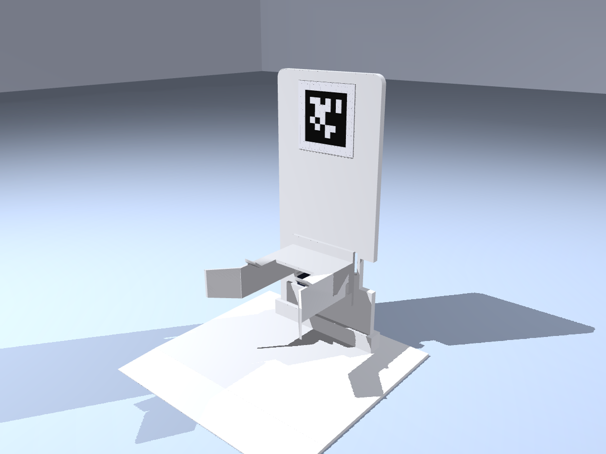 | 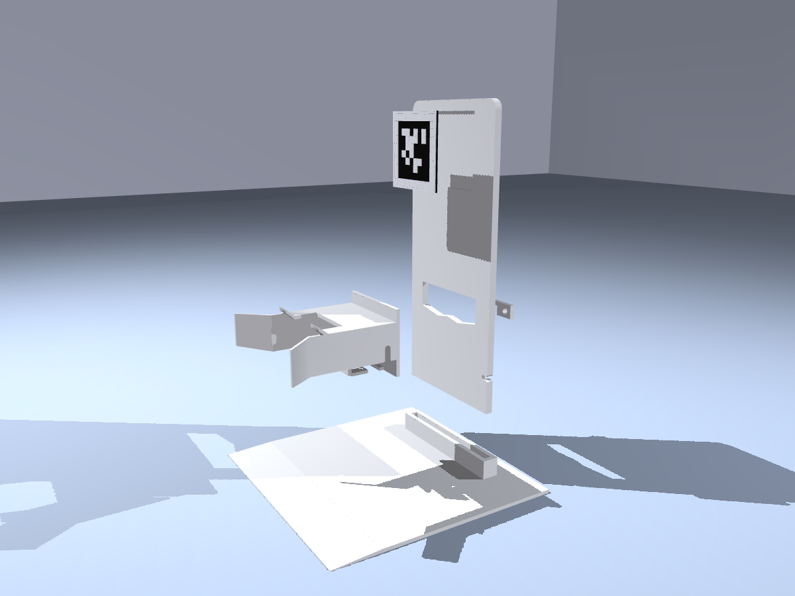 | 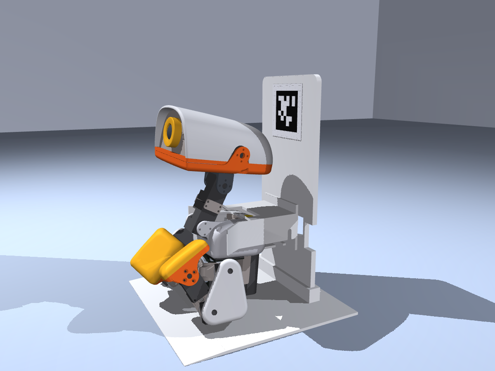 |

[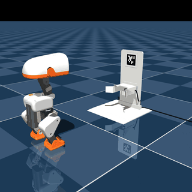](media/preview.mp4)

**Status:** designed and tested in simulation only, like the MicroDock; not yet tried on hardware.
- **The butt walks:** two new policies, trained for this dock in simulation (see [`training/`](training/README.md)).
  They have not run on a robot yet.
- **The behaviour around them:** these are scripted in the simulation, not implemented on the robot:
  - tag detection, the turn and the sit;
  - stopping on USB power;
  - going to sleep and waking;
  - leaving when charged.

## How docking works

1. **Find the dock and turn around:** as on the MicroDock. The duck walks toward the tag and turns in place about 200 mm
   from the board. It turns 6.6° past straight, because the sit turns it back by about that much.
2. **Sit:** the official `alpha_sitstand` policy sits the duck down. It moves back about 65 mm while sitting.
3. **Butt-walk back:** the docking butt walk (`policy/butt_walk.onnx`) scoots backward on its seat at about 4 cm/s,
   holding its heading, for the last 6–9 cm. On the way in, as on the MicroDock:
   - the hood's flared side walls line the duck up;
   - the hood rides up onto its back, floating up to 20 mm sideways;
   - the magnetic tip meets the adapter, and the magnet closes the last millimetre.
4. **Rest:** when USB power appears, it stops (the all-zero command) and sits still while it charges.
   - The duck sits level, so the adapter is at the port's height, as on the MicroDock.
   - In the showcased run it also goes to sleep: the legs go limp, the head sinks onto its stops, and every servo
     switches off.

## How undocking works

1. **Wake:** the servos come back on, and the duck returns to its seated pose in a second.
2. **Scoot out:** the undocking butt walk (`policy/butt_walk_undock.onnx`) scoots forward, holding its heading. It
   breaks free of the magnet about a second in and is 70 mm out after about two.
3. **Stand up:** the official `alpha_sitstand` policy stands the duck up, clear of the hood.
4. **Walk off:** the official `velstand` policy.

## Simulation result

- **Policies:**
  - the official `velstand.onnx` (walk) and `alpha_sitstand.onnx` (sit, stand), unmodified;
  - `butt_walk.onnx` (docking) and `butt_walk_undock.onnx` (undocking).

  All of them run on the BAM XL330 actuator model (`microduck_rl` develop `bae39f59`).
- **Starts:** 380–460 mm out, ±40 mm sideways, heading 180 ± 12°. The tag estimate is the true position plus noise,
  σ = 5 mm along, 3 mm across and 1°.
- **Seat friction:** 0.45, a plastic shell on PLA. The butt walks trained with 0.3–1.0 (undocking 0.25–0.7).

**Docking** (`sim/docking_seated.py`):

| Batch | Docked (USB connected and holding while it rests) | Hood touched the power button |
|---|---|---|
| [`results/seated30.json`](results/seated30.json) (seeds 41, 42, 43 × 10) | **30 / 30** | 0 runs |
| [`results/seat_friction.json`](results/seat_friction.json): seat friction 0.3 / 0.8 (10 each) | 10 / 10, 10 / 10 | 0 runs |

- **Accuracy:** every docked run ended within 0.1 mm of the adapter along the push, 0.6 mm sideways and 0.5 mm
  vertically.
- **Spread after the sit:** the duck sat −18 to +14 mm off-centre and −6° to +8.5° off; the flares and the floating hood
  absorbed it.

**Undocking** (`sim/undocking_seated.py`): each run docks as above, rests, then scoots out, stands up and walks off.
Both butt walks run with the training's latencies.

| Batch | Docked | Broke free | Stood up | Walked off |
|---|---|---|---|---|
| [`results/undock30.json`](results/undock30.json): magnet 4 N (seeds 41, 42, 43 × 10) | 30 / 30 | **30 / 30** | 30 | 30 |
| [`results/undock_magnet.json`](results/undock_magnet.json): magnet 6 N (10) | 10 / 10 | 10 / 10 | 10 | 10 |
| magnet 8 N (10) | 10 / 10 | 2 / 10 | 1 | 1 |

- **Breaking free:** at 4 N it broke free 1.06 s into the scoot (median, at most 1.34 s); at 6 N, 1.49 s (at most
  5.3 s).
- **Standing up:** in two of the 40 runs at 4 and 6 N, the duck brushed the hood as it stood up (at most 5.6 N).
- **At 8 N:** it mostly can't break free, and standing up under the hood jams it.
- **Latency:** the undocking policy only breaks free with the training's latencies (`sim/latency.py`), which make it
  push in the rhythm it was trained with. Without them it gets free once in ten. The robot's real latency and the real
  magnet's pull are not measured yet.

### Experimental: one policy for both

[`policy/experimental/butt_walk_dock_undock.onnx`](policy/experimental/butt_walk_dock_undock.onnx) both backs in and
scoots out; only the command's sign differs. With one policy, a duck that docked crooked could pull forward and try
again without switching policies.

In the same simulation it docked and undocked 30/30 at 4 N and 10/10 at 6 N
([`results/experimental_dock_undock.json`](results/experimental_dock_undock.json)). It is experimental: it was evaluated
less than the two released policies, and its training environment's own check disagrees with these results. See
[`training/`](training/README.md#experimental-one-policy-for-both).

## Parts and printing

Print the MicroDock's hood, base, keeper and tag ([`../microdock/stl`](../microdock/stl)) and the v2 board,
[`stl/microdock_v2_board.stl`](stl/microdock_v2_board.stl). If you already printed a MicroDock, print only the board.

For a Bambu Lab P1S, [`print/microdock_v2_P1S.3mf`](print/microdock_v2_P1S.3mf) is a ready project with all three plates.
It is set up like the MicroDock's ([how to print](../microdock/print/README.md)), with the v2 board on plate 2. Bambu
Studio's estimates:

| Plate | Time | PLA |
|---|---|---|
| 1 | 2 h 9 min | 101 g |
| 2 | 3 h 1 min | 130 g |
| 3 | 22 min | 9 g |

That's about 5 h 32 min and 240 g in all.

The [assembly manual](#assembly) below shows what to buy and how to put it together.

## Assembly

The assembly manual. Print the [PDF](media/microdock_v2_assembly.pdf) at 100 % to use page 2's 1:1 check of the cable's
thickness.

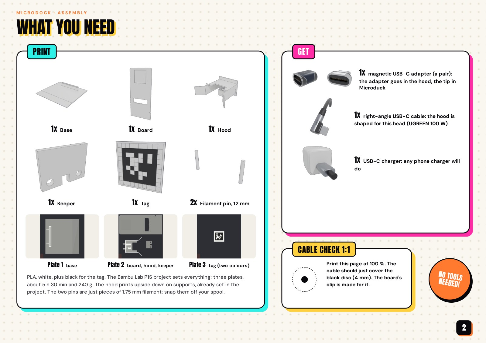
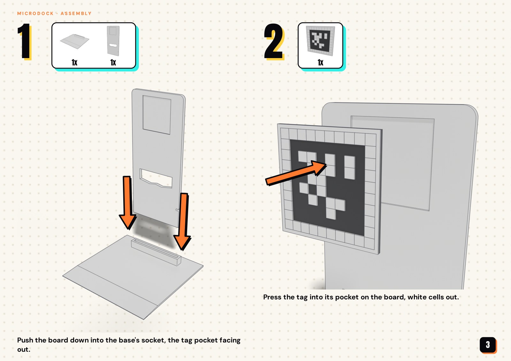
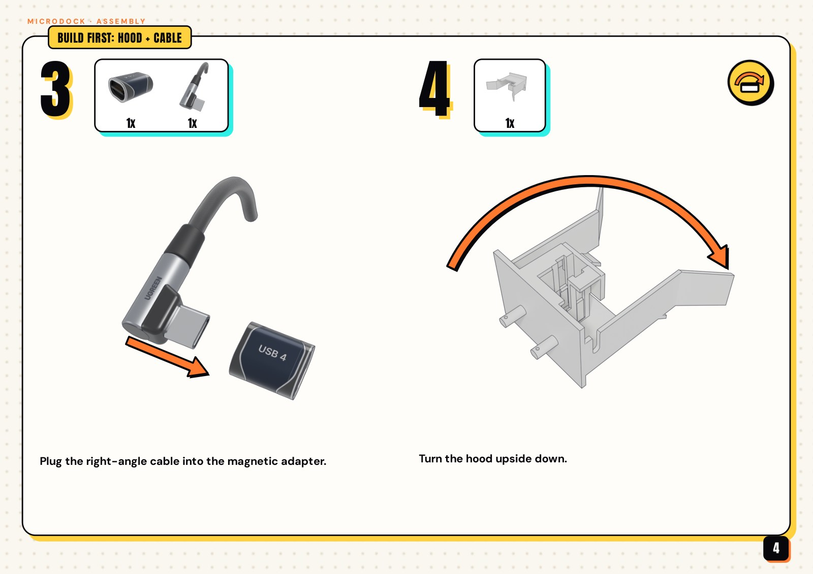
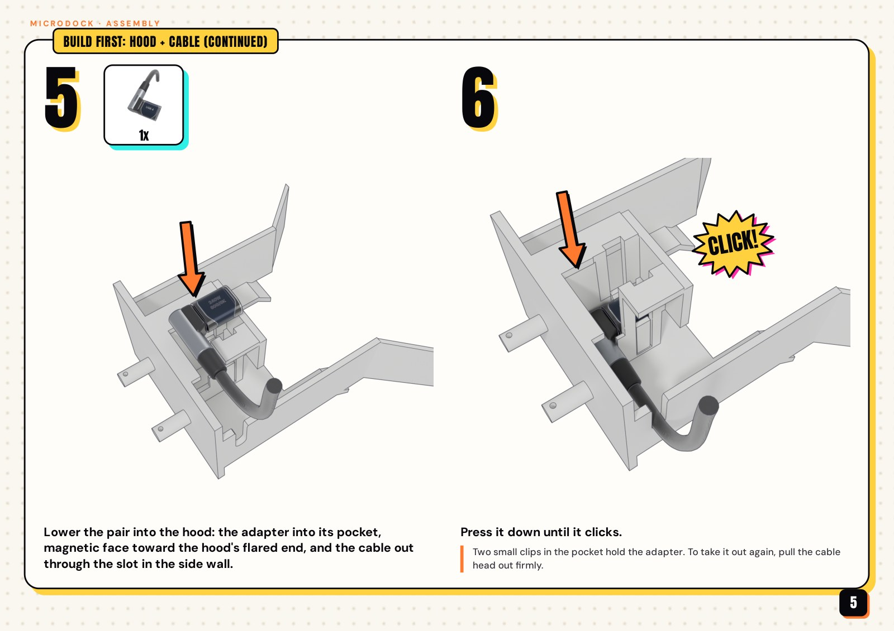
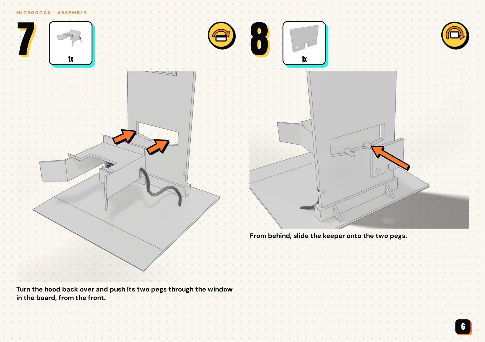
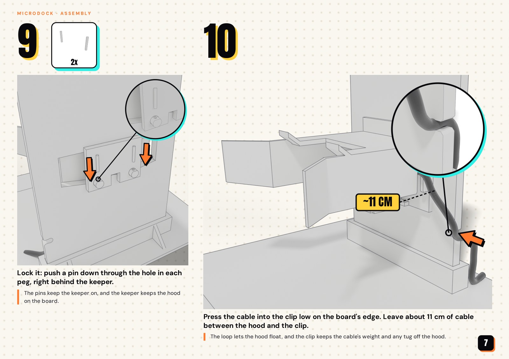
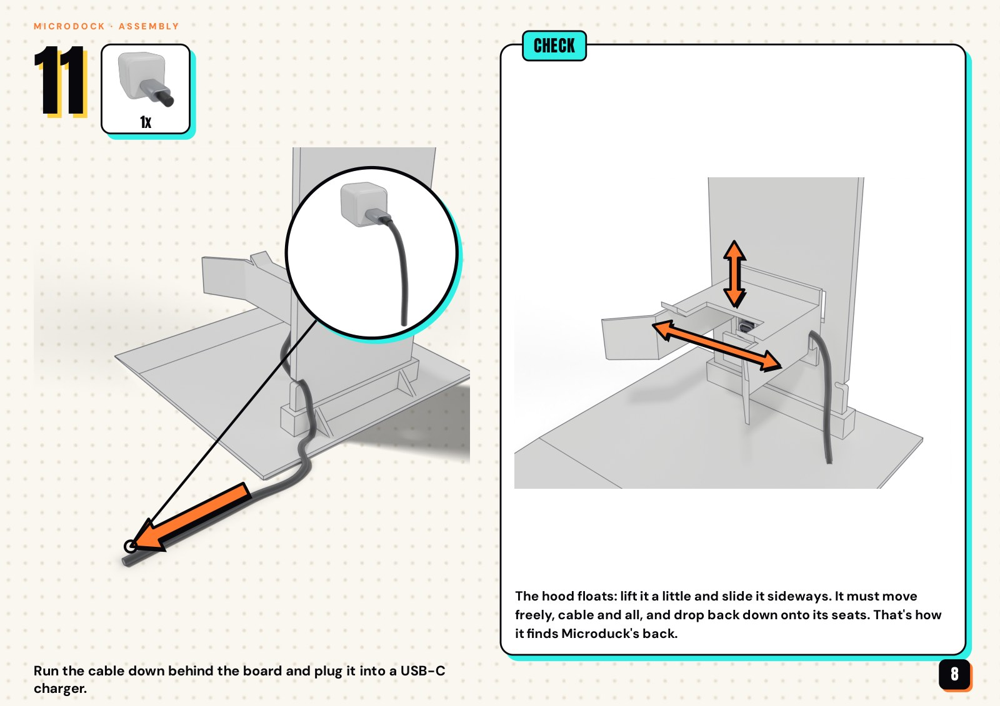
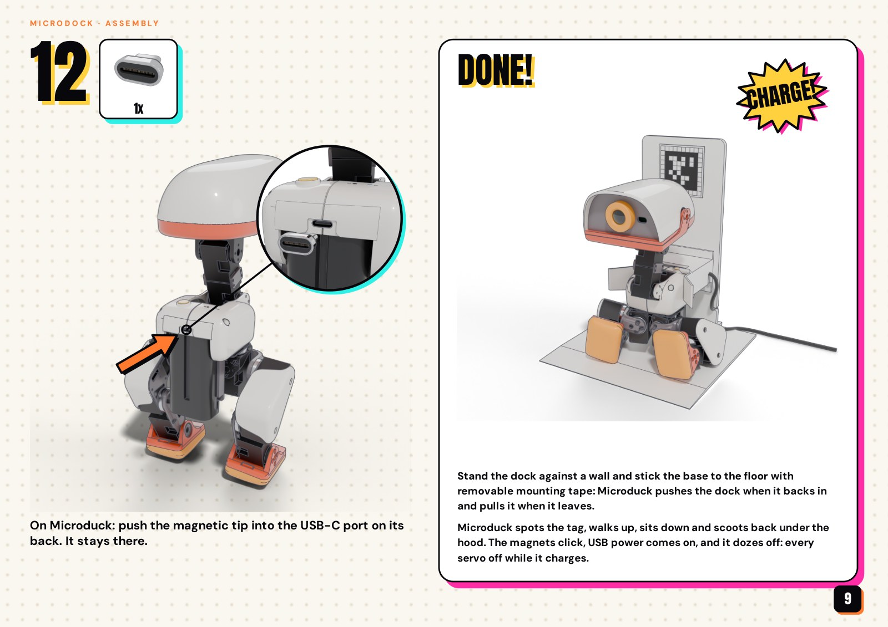

## What the simulation leaves out

The simulation holds the dock still and moves the hood on two sliders, so these were checked separately:
- **The keeper:** it keeps the hood on the board. The hood leans forward on its pegs, and undocking pulls it forward
  through the magnet. `keeper_fit` in `../microdock/source/cad.py` checks every hood position (`build.py --check`
  runs it): at least 274 mm² of the keeper always bears on the board. Two filament pins lock it on the pegs.
- **Re-centring:** the V-seats under the pegs (about 10°) are too shallow to centre the hood against PLA's friction,
  so after an off-centre docking it stays where it was left. With the simulator's centring spring removed and the hood
  starting off-centre: ±10 mm docked 30/30 each, −20 mm 29/30, +20 mm 27/30.
- **Holding the dock in place:** backing in pushes the dock back by up to about 3 N (peaks to 6 N) and scooting out
  pulls it forward by up to about 3 N, with the duck's weight only partly on the plate. A free-standing 240 g dock
  would slide on a smooth floor: stand it against a wall and fix the base down (the manual's last page).
- **The cable loop:** as the hood floats, its cable exit moves 39 to 66 mm from the board's clip. Leave about 11 cm.
- **The hood's weight:** the print with its adapter and cable head is about 45 g, the simulator's hood 28 g. With
  45 g it still docked 30/30.
- **The magnet and the latency:** the undocking depends on the magnet's pull and on the robot's latency, and neither
  is measured yet (see above).

## Reproduce

The parts: the board, the print plates, and the checks that the cable head fits the hood and its catch and that the
other parts are the MicroDock's.

```bash
uv run hardware/microdock-v2/source/build.py --check
uv run hardware/microdock-v2/source/build.py --bambu /path/to/bambu-studio --check   # also the Bambu Studio project
```

The simulation needs the same checkout and official policies as the MicroDock's. The butt walks are in `policy/`.

```bash
export MICRODUCK_RL_DIR=/path/to/microduck_rl MICRODUCK_POLICY_DIR=/path/to/microduck-policies
uv run python hardware/microdock-v2/sim/docking_seated.py --seeds 41,42,43 --n 10 --out results.json
uv run python hardware/microdock-v2/sim/undocking_seated.py --seeds 41,42,43 --n 10 --mag 4 --out undock.json
# the showcased run (dock, go to sleep, wake, undock, stand up, walk off) and the preview video
uv run python hardware/microdock-v2/sim/docking_seated.py --n 1 --seed 0 --noise 0 --start 450,15,178 --hold 4 \
    --rest limp --doze_pause 0.1 --handover_s 0 --sit_until_still --save run.pkl
uv run python hardware/microdock-v2/sim/undocking_seated.py --continue run.pkl --save full.pkl
MUJOCO_GL=egl uv run --with manifold3d python hardware/microdock/sim/render_preview.py full.pkl preview.mp4 --end 0.06,0.0,0.085,0.62 --gif_to end
# the gallery, from a docked run
uv run python hardware/microdock-v2/sim/docking_seated.py --n 1 --seed 0 --noise 0 --start 450,15,178 --hold 4 --save docked.pkl
MUJOCO_GL=egl uv run --with manifold3d python hardware/microdock/sim/render_gallery.py docked.pkl hardware/microdock-v2/renders
```

## Files

- `source/seated.py`: the seated parameters, the MicroDock's with three changes:
  - the hood lower;
  - more sideways float;
  - more drop.
- `source/build.py`: the board, the print plates and the Bambu Studio project.
- `stl/`, `print/`: the v2 board, and the P1S plates with it.
- `sim/docking_seated.py`: the docking trials (walk, turn, sit, butt walk, connect, rest).
- `sim/undocking_seated.py`: the undocking trials (dock, scoot out, stand up, walk off), and the continuation of a saved
  run.
- `sim/latency.py`: the training's latencies, for the butt walks.
- `sim/bw_eval.py`: the docking butt walk's command battery (speed, turning, stillness, tilt, head).
- `policy/butt_walk.onnx`, `policy/butt_walk_undock.onnx`: the docking and undocking butt walks (61 inputs,
  14 outputs, the observation normalizer baked in).
- `policy/experimental/butt_walk_dock_undock.onnx`: the experimental single policy.
- `training/`: the environment they were trained in, and how.
- `results/`, `media/`, `renders/`: the trial results, the preview and the gallery.
- `media/assembly/`, `media/microdock_v2_assembly.pdf`: the assembly manual.

## License

As the MicroDock:
- **Hardware:** the printable meshes in `stl/` and `print/` are 3D hardware design files, licensed
  [CC BY-NC-SA 4.0](../../LICENSE-HARDWARE).
- **Software:** the scripts, the training environment and the policies are under the repository's
  [Apache-2.0](../../LICENSE) license.
