# MicroDock v3: the egg dock

The [MicroDock v2](../microdock-v2/README.md)'s seated docking with a new dock: the hood floats on **printed springs
hidden inside an egg**. Microduck sits down, scoots back under the hood, rests while it charges, and scoots out and
walks off when it is charged, with v2's scoot policies. Nothing sticks out above the hood, and it is fully printed:
no screws or glue.

## Assembly

The assembly manual. Print the [PDF](media/microdock_v3_assembly.pdf) at 100 % to use page 2's 1:1 check of the
cable's plug. The parts and a ready Bambu Studio project are under [Parts and printing](#parts-and-printing).

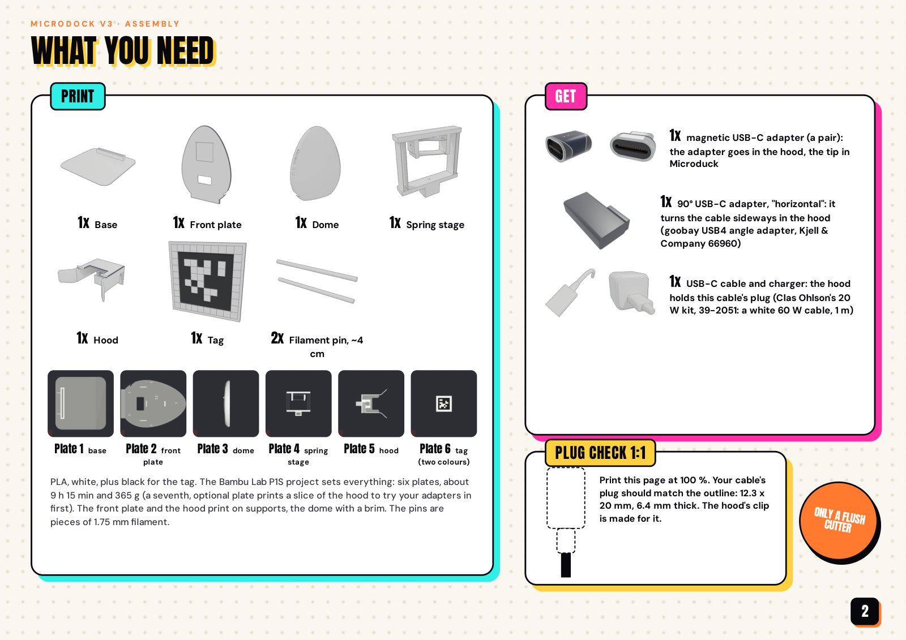
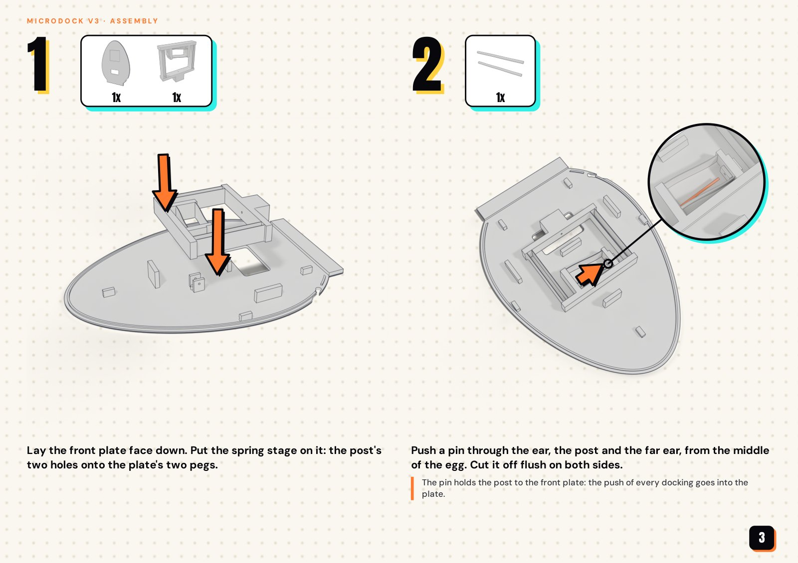
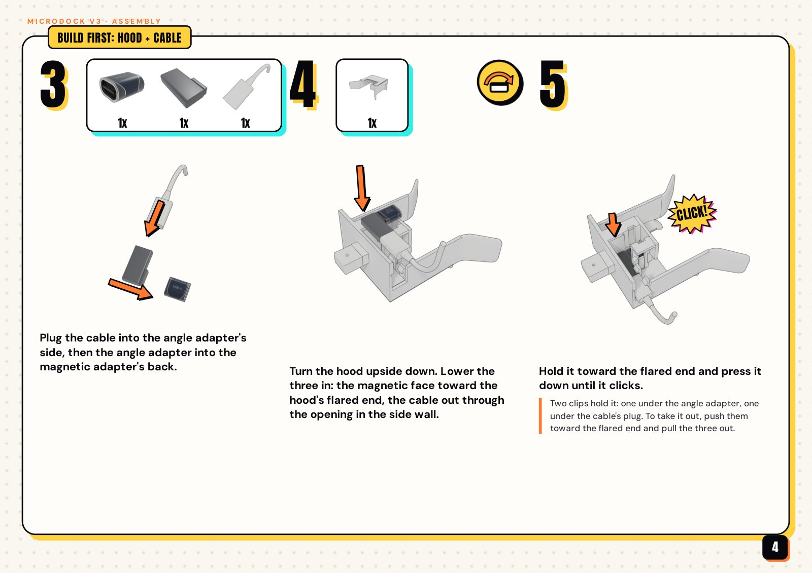
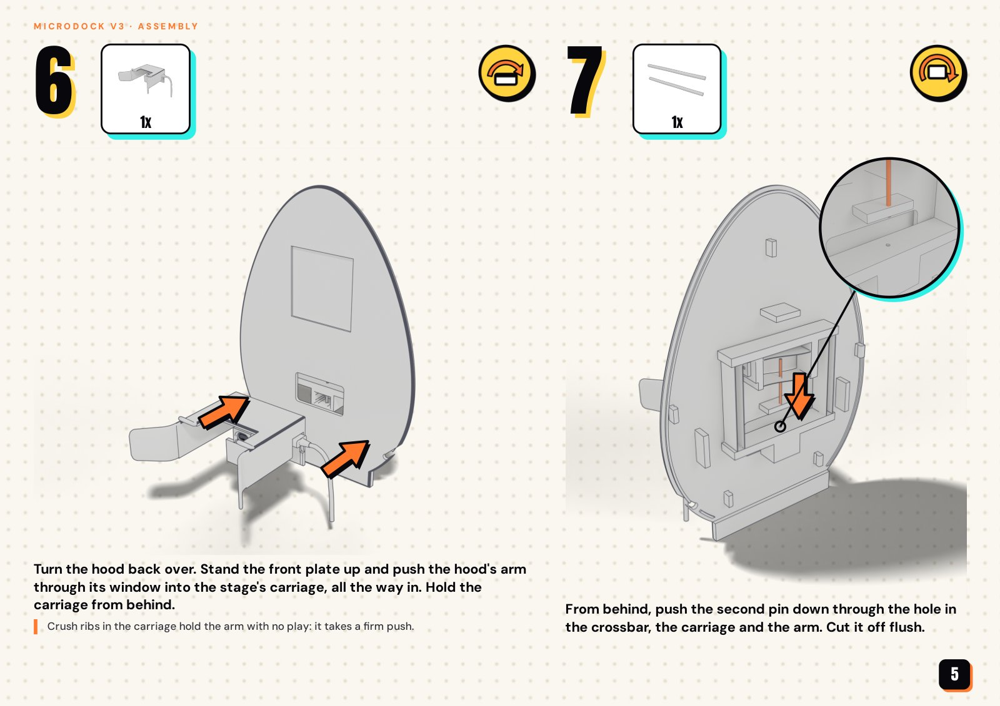
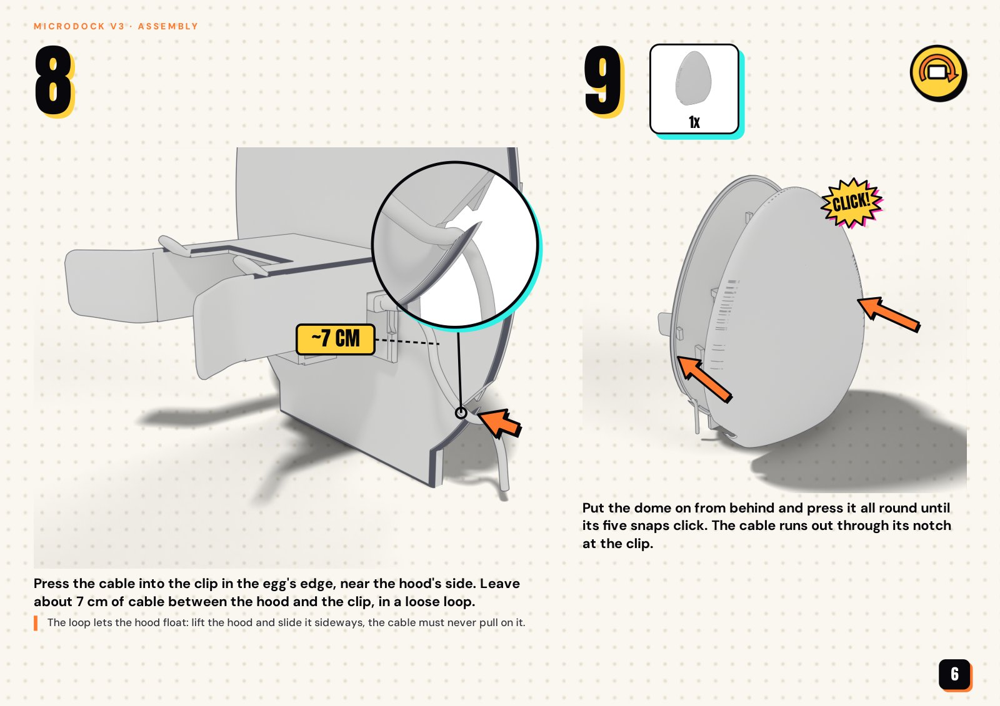
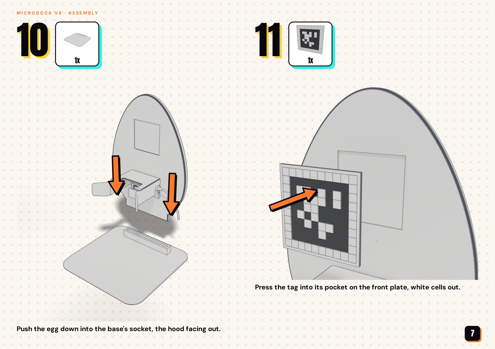
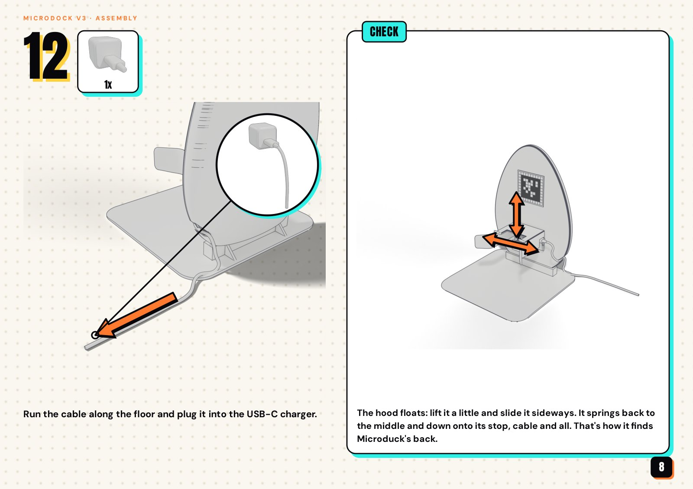
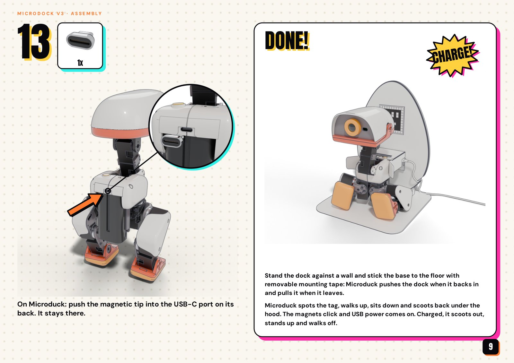

## What it does

1. It walks up to the dock's AprilTag, turns around and sits, as with the MicroDock v2.
2. It **scoots backward on its seat** (v2's docking policy) until the magnetic tip in its USB-C port meets the adapter
   in the dock's floating hood, and stops when USB power appears.
3. When it is charged, v2's undocking policy scoots it out against the magnet. The official sit policy stands it up and
   the official walk takes it away.

**What's new: the dock.** On the MicroDock and v2 the hood slides on two pegs through a window in the board. Here it
rides on a spring stage, printed in PLA and hidden between the egg's front plate and its domed back:
- **It floats:** up to 15 mm up and 16 mm to either side, and springs back to the middle. The pegs' friction is gone.
- **It's stiff where it must be:** toward the egg the stage barely moves, so the push of docking and the magnet's pull
  when undocking go into the egg, not into the springs.
- **The cable:** a straight USB-C cable through a 90° adapter. The magnetic adapter, the angle adapter and the cable's
  plug sit in the hood as one stack, held by clips, and the cable leaves through the hood's side.

| Assembled | Printed parts | Docked |
|---|---|---|
| 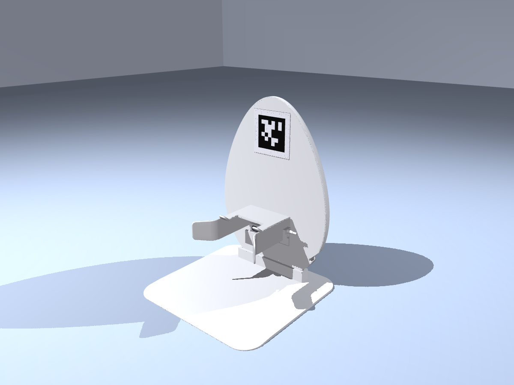 | 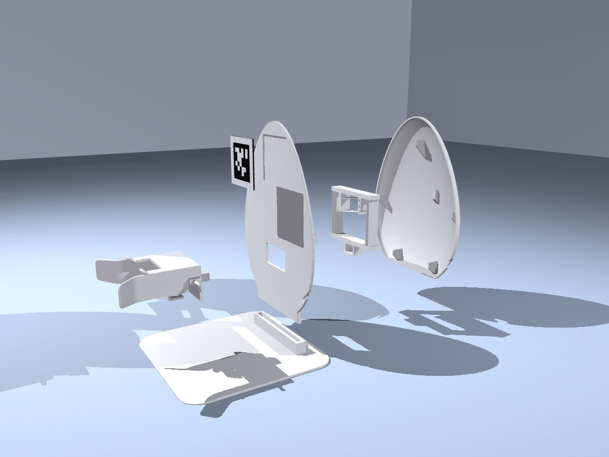 | 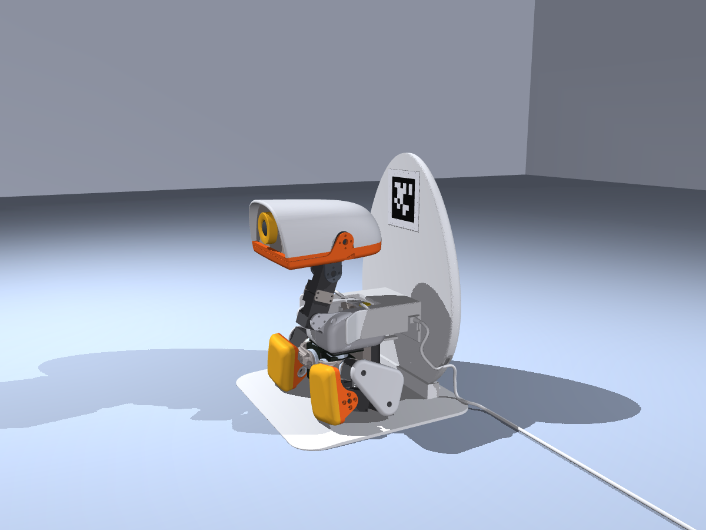 |

[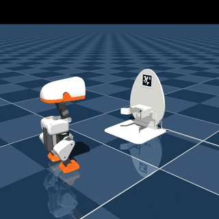](media/preview.mp4)

**Status:** printed, assembled and tried by hand; the docking and undocking moves run in simulation only.
- **The policies:** v2's scoot policies, unchanged ([`../microdock-v2/policy`](../microdock-v2/policy)). They have not
  run on a robot yet.
- **The behaviour around them** is scripted in the simulation, as for v2: tag detection, the turn and the sit, stopping
  on USB power, leaving when charged.

## How the hood floats

The spring stage is one print (plate 4). From the front plate to the hood:

1. **The post** stands on two pegs on the front plate's back. A 1.75 mm filament pin runs through it and through the
   two ears beside it, so the push of every docking goes into the front plate.
2. **Two lift blades** (0.4 mm thick, 42 mm long) carry the hanger up and down only. They are printed 5 mm above rest:
   at rest the hood sits on a stop with 0.33 N, and docked it rests on the duck's back with 1.1 N.
3. **Four hanging blades** (64 mm) hang the carriage from the hanger. They swing sideways, always pulled, never
   pushed.
4. **The carriage** holds the hood's arm, which reaches through a window in the front plate behind the hood. Crush ribs
   take up the arm's play and a second filament pin, down through the crossbar, the carriage and the arm, carries the
   undocking pull.

Springs: 67 N/m sideways, 97 N/m up. Stops limit the travel to 15 mm up and 16 mm to either side, and everything
that swings stays inside the egg (`fit()` in `source/flexdock_c.py`). The blades are 16 mm deep, so the hood can tilt
a little but hardly move toward the egg.

## How docking works

As on v2 (see [How docking works](../microdock-v2/README.md#how-docking-works)): the duck turns about 200 mm from the
dock, sits, and scoots back the last 6–9 cm. On the way in:
- the hood's flared side walls line the duck up;
- the hood rides up onto its back (up to about 14 mm), floating sideways as it needs;
- a lead-in round the adapter's face guides the tip's head the last millimetre, and the magnet closes it.

The stack floats 1.45 mm along the docking direction between two stops in the hood: the tip pushes it back as it
docks, and undocking pulls it forward onto its front stop. The clips keep it from dropping out.

## How undocking works

As on v2: the undocking policy scoots forward against the magnet, breaks free about 1.3 s in, the official sit
policy stands the duck up clear of the hood and the official walk takes it off. The stage springs the hood back to the
middle and down onto its stop.

## Simulation result

- **Policies:** the official `velstand.onnx` (walk) and `alpha_sitstand.onnx` (sit, stand), unmodified, and v2's
  `scoot_dock.onnx` and `scoot_undock.onnx` with the training's latencies. All on the BAM XL330 actuator model
  (`microduck_rl` develop `bae39f59`).
- **The hood:** on the stage's springs and stops (sideways 67 N/m, up 97 N/m, its tilt as the blades let it), 83 g,
  with the stack at its front stop. The magnet pulls 4 N.
- **The cable:** a spring at the cable's exit, 3 N/m with a 0.1 N preload in a random direction; and a stiff cable,
  10 N/m and 0.4 N.
- **Starts:** 380–460 mm out, ±40 mm sideways, heading 180 ± 12°, the tag estimate with noise, as v2.

Each trial docks, rests 2 s, scoots out, stands up and walks off
([`results/egg_dock_trials.json`](results/egg_dock_trials.json), seeds 41–49 × 10):

| Cable | Docked | USB dropouts | Broke free | Stood up | Walked off |
|---|---|---|---|---|---|
| normal | **90 / 90** | 0 | 90 | 90 | 90 |
| stiff | **90 / 90** | 0 | 90 | 89 | 90 |

- **Accuracy:** at the first touch the tip was within 1 mm of the adapter's axis sideways and 0.7 mm vertically,
  tilted at most 3.1°; every docked run ended within 0.3 mm.
- **The hood:** it rose 12–15 mm onto the duck's back and floated about 7 mm sideways (median), reaching its side
  stops in 3 of the 180 runs. Toward the egg it moved at most 0.7 mm.
- **Breaking free:** 1.3 s into the scoot (median; at most 1.7 s).
- **Standing up:** in 15 of the 180 runs the duck touched the hood as it stood up, at most 12 N. One stiff-cable run
  was slow to stand up.

## Parts and printing

Six printed parts and two pins: [`stl/`](stl) holds the parts as designed, [`print/`](print) each plate laid out and
the Bambu Studio project. For a Bambu Lab P1S, [`print/microdock_v3_P1S.3mf`](print/microdock_v3_P1S.3mf) is a ready
project, set up like the MicroDock's ([how to print](../microdock/print/README.md)): PLA, 0.4 mm nozzle, 0.20 mm
Standard. Bambu Studio's estimates:

| Plate | Part | How it prints | Time | PLA |
|---|---|---|---|---|
| 1 | Base | as it sits | 2 h 8 min | 100 g |
| 2 | Front plate | face down, supports under the tag pocket's floor | 2 h 4 min | 89 g |
| 3 | Dome | standing on its floor, brim | 2 h 31 min | 100 g |
| 4 | Spring stage | flat, no supports (Arachne walls for the 0.4 mm blades) | 40 min | 19 g |
| 5 | Hood | upside down, supports | 1 h 30 min | 48 g |
| 6 | Tag | black base, then the white cells | 22 min | 9 g |
| 7 | Hood fit test (optional) | the hood's middle, as plate 5 | 33 min | 13 g |

Plates 1–6: about 9 h 15 min and 365 g. Plate 7 prints the hood's slice round the adapters, to try the magnetic
adapter, the angle adapter and the duck's tip before printing the hood.

The pins are two pieces of 1.75 mm PLA filament, about 4 cm each, cut flush once they are in.

### Bill of materials

| Item | What we use |
|---|---|
| Magnetic USB-C adapter, 2-pack (24-pin, passes CC, so chargers switch on) | Auravale 240 W, as the MicroDock's |
| 90° USB-C adapter, "horizontal": the hood holds this one and turns the cable sideways | goobay USB4 angle adapter, Kjell & Company 66960 |
| USB-C cable: the hood's clip holds this one's plug (12.3 × 20 mm, 6.4 mm thick) | white 60 W, 1 m, in Clas Ohlson's 20 W charger kit 39-2051 |
| USB-C charger, or any phone charger you have | the same kit's 20 W charger |

These replace the MicroDock's right-angle cable: the hood is shaped for this angle adapter and plug, and checked
against calipered parts. The [assembly manual](#assembly) above shows how it all goes together.

## What the simulation leaves out

- **The blades themselves:** the simulator moves the hood on springs and stops with the stage's stiffness, not on bending
  PLA. `fit()` and the build's checks keep the stage clear of the dome and the egg's wall over the whole travel.
- **The stack's float:** the simulator holds the adapter at its front stop. The real stack floats 1.45 mm between its
  stops.
- **The cable:** a spring at its exit. The loop to the egg's clip isn't simulated: leave about 7 cm, loose, so the
  hood can float.
- **Creep:** PLA under a constant load creeps. At rest the stop, not the springs, sets where the hood sits, so a
  softening spring moves the hood's rest very little.
- **The magnet and the latency:** as v2, neither is measured yet.
- **Holding the dock in place:** as v2: stand it against a wall and tape the base down.

## Reproduce

The parts, the print plates and the checks (the parts fit together, the stage clears the dome over its travel, the
pins have their run, the adapters and the plug fit the hood and its clips):

```bash
uv run hardware/microdock-v3/source/flexdock_c_build.py --check
uv run hardware/microdock-v3/source/flexdock_c_build.py --bambu /path/to/bambu-studio --check   # also the Bambu Studio project
```

The simulation needs the same checkout and official policies as the MicroDock's; the scoot policies are v2's.

```bash
export MICRODUCK_RL_DIR=/path/to/microduck_rl MICRODUCK_POLICY_DIR=/path/to/microduck-policies
C="--k_y 67 --k_z 97 --z_neutral 5 --z_travel 15 --hood_mass 0.083 --x_solref 0.03"
TILT="--k_rxyz 92.3,12.5,55.3 --rot_pivot=-12.5,0,136.5 --rot_solref 0.025,0.053,0.041"
GB="--tip 3.2,11.2,6.8,1.65,11.85,7.6 --plug 8.11,12.91,14.27 --face_offset 0.80 --guide 11.8,7.4,0.25,0.1,1.35 --cable_out=-72.02,47.15,26.5"
SEEDS=41,42,43,44,45,46,47,48,49
uv run python hardware/microdock-v3/sim/swing_trials.py --design flex $C $TILT $GB --seeds $SEEDS --n 10 --out normal.json
uv run python hardware/microdock-v3/sim/swing_trials.py --design flex $C $TILT $GB --cable_k 10 --cable_pre 0.4 --seeds $SEEDS --n 10 --out stiff.json
# the showcased run (seed 41's first trial), the preview video and the gallery
uv run python hardware/microdock-v3/sim/swing_trials.py --design flex $C $TILT $GB --seeds 41 --n 1 --save run.pkl
MUJOCO_GL=egl uv run --with manifold3d python hardware/microdock-v3/sim/render_preview.py run.pkl preview.mp4
MUJOCO_GL=egl uv run --with manifold3d python hardware/microdock-v3/sim/render_gallery.py run.pkl hardware/microdock-v3/renders
```

## Files

- `source/flexdock_c.py`: the egg dock: the front plate, the dome, the spring stage, the hood with its stack's stops and
  clips, and the geometry the checks use.
- `source/flexdock_c_build.py`: the parts, the print plates, the Bambu Studio project and the checks.
- `source/flexdock.py`: the hood on springs in the simulator (`FlexDock`, `build_scene`) and the first spring egg the
  dock grew from.
- `source/swing.py`, `strapswing.py`, `flexstrap.py`, `strapdock_build.py`: the experiments on the way, the hood
  hanging on cords, rods and flex straps. The egg dock takes its egg outline, base, scene and plate helpers from them.
- `sim/swing_trials.py`: the docking and undocking trials (`--design flex`: the egg dock).
- `sim/egg_visuals.py`, `sim/render_preview.py`, `sim/render_gallery.py`: the preview and the gallery.
- `stl/`, `print/`: the parts, and the P1S plates with the project.
- `results/`, `media/`, `renders/`: the trial results, the preview and the gallery.
- `media/assembly/`, `media/microdock_v3_assembly.pdf`: the assembly manual.

It builds on the MicroDock's modules (`../microdock/source`: `dock.py`, `cad.py`, `plates.py`, `bambu_project.py`;
`../microdock/sim`) and v2's (`../microdock-v2/source/seated.py`, `../microdock-v2/sim`, `../microdock-v2/policy`).

## License

As the MicroDock:
- **Hardware:** the printable meshes in `stl/` and `print/` are 3D hardware design files, licensed
  [CC BY-NC-SA 4.0](../../LICENSE-HARDWARE).
- **Software:** the scripts are under the repository's [Apache-2.0](../../LICENSE) license.
