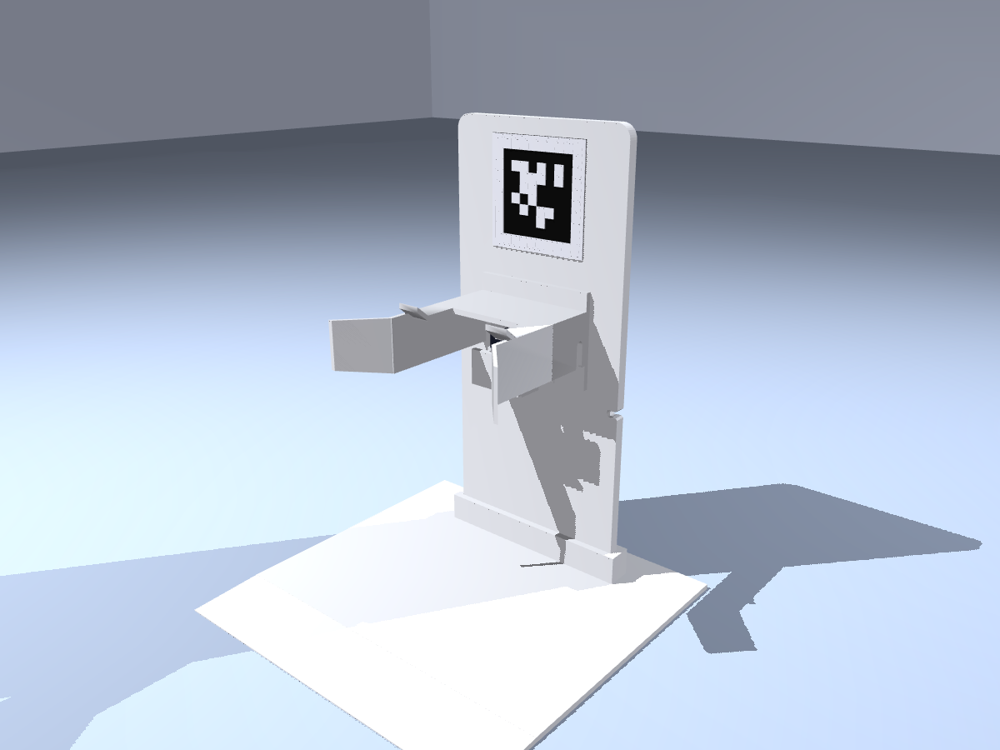
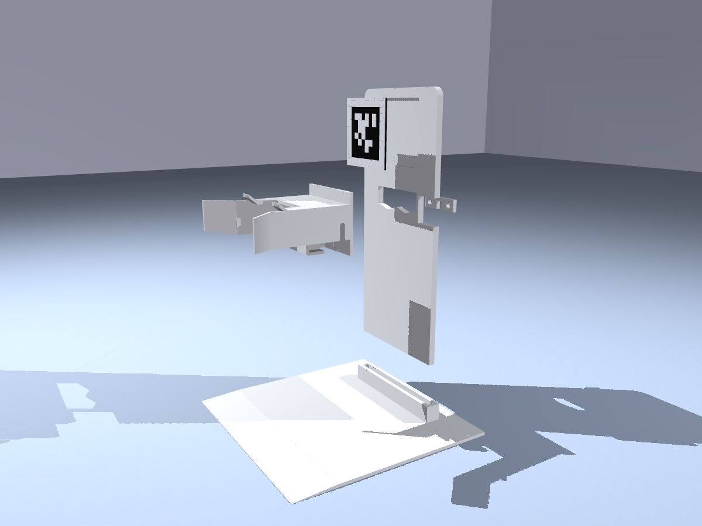
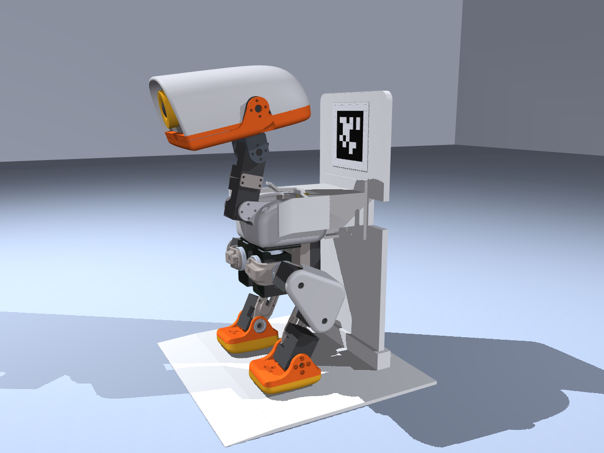
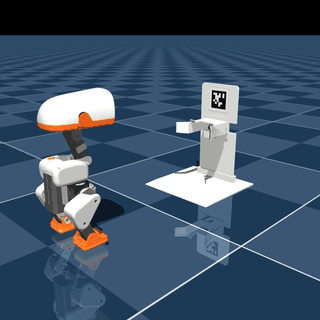

# MicroDock: a self-charging dock for Microduck

Microduck walks up to the dock's AprilTag, turns around in place, and backs in. A floating hood on the dock's board
settles onto its back. The hood's side walls line the duck up, and a magnetic USB-C adapter in the hood meets a magnetic
tip that lives in **Microduck's own USB-C port**, on its back just above the battery. The duck stops walking when USB
power appears, then stands and charges.

- **No extra battery:** it charges Microduck's own battery through the robot itself.
- **Fully printed:** no screws, inserts, springs or rubber feet.
- **Leaves the controls alone:** the hood rides on two skids that straddle the power button and the status lights on
  the top of the duck's back.

| Assembled | Printed parts | Docked |
|---|---|---|
|  |  |  |

[](media/preview.mp4)

**Status:** designed and tested in simulation only; not yet printed or tried on hardware. The docking behaviour (tag
detection, the turn and stopping on USB power) is scripted in the simulation, not implemented on the robot.

## What it relies on

- **Onboard charging.** Pollen says the final production units will have it
  ([microduck#174](https://github.com/pollen-robotics/microduck/issues/174)). The current beta boards do not charge
  over USB-C (their USB-C port only reaches the 5 V rail).
- **The back of recent units.** Photos of several recent units show:
  - the USB-C port centred on the shell's seam, just above the battery. It sits in a tight cut-out in the bottom edge
    of the white shell halves, set slightly deeper than the shell. The cut-out's top edge hugs the port, and its sides
    curve out into the edge of the battery opening;
  - the yellow power button, in a raised white collar, on the top face at the rear of the shoulders (the duck's left);
  - two status lights on the top face, on the other side.

  From the photos, the port's centre is about 4.5 mm above the shell's edge over the battery, and the cut-out is about
  12 mm wide. These are estimates from photos. Measure them on a real unit; `port_above_bat`, `notch_w`, `port_recess`,
  `shell_back_x`, `button_xy`, `leds_xy`, `skid_y` and the hood dimensions in `source/dock.py` follow them.
- **The magnetic tip in the cut-out.** The tip's head (11.8 × 6 mm) fits the cut-out's width but is taller than the
  space above the port. So it rests against the shell at the cut-out's top edge, and its plug reaches about 5.85 mm
  (of 6.65 mm) into the recessed port. Check that the plug fits and makes contact on a real unit.
- **The robot model.** The official model has the older back, where the battery reaches the top of the body. To match
  the newer back, the simulation lowers the battery 10 mm and fills the space above it with a collision box for the
  shell, and adds the power button's collar on the top face as a collision shape, so it can check that the hood never
  touches it. Masses and inertias are unchanged. For the renders, `sim/back_patch.py` builds the newer back as a visual
  mesh: each official shell half's back is a panel angled 3.4° in plan, and the new area continues those panels and
  their vertical curve as one smooth surface, with the cut-out and the recessed port.

## How docking works

1. **Find the dock.** The duck walks toward the tag (in simulation: true position plus noise, σ = 5 mm along, 3 mm
   across, 1° heading) and steers onto the dock's centre line.
2. **Turn in place.** It stops about 24 cm from the board and turns 180°. It aims 12 mm to one side, because the turn
   shifts it sideways by that much on average.
3. **Back in.** It walks backward (`velstand`, vx = −0.4) and holds its heading with the gyro. On the way in:
   - the front lips of the hood's two skids ride up onto the top of the duck's body, outside the button and the lights;
   - the hood's flared side walls catch the body and line it up (the hood floats ±12 mm sideways and rises with the duck);
   - a stop under the hood meets the battery 0.3 mm after the tip touches the adapter, so the push goes into the
     battery instead of through the magnetic tip.
4. **Stop on power.** When the magnetic tip meets the adapter, USB power appears and the duck stops walking. The magnet
   closes the last millimetre.

## Simulation result

- The official `velstand.onnx` walking policy, unmodified, on the BAM XL330 actuator model.
- Starts 380–460 mm out, ±40 mm sideways, heading 180 ± 12°.
- The magnet is modelled as a 4 N pull within 4 mm of the adapter, plus a soft centring force.

| Batch | Docked (USB connected and holding) | Hood touched the power button |
|---|---|---|
| [`results/backin30.json`](results/backin30.json) (seeds 41, 42, 43 × 10) | **30 / 30** | 0 runs |

- Every run ended within 0.4 mm of the adapter in every direction.
- The duck finished its turn up to 32 mm off-centre and 7° off; the flares and the floating hood (which moved up to
  6.3 mm sideways) absorbed it.
- The hood is rigid along the docking direction. A version where the hood could slide back against a spring docked no
  better.

## Parts and printing (Bambu Lab P1S, PLA)

Ready-to-print plates for a P1S are in [`print/`](print/README.md): three plates, because the base and the board
don't fit one 256 × 256 mm plate together. Each plate has a 3MF that opens in Bambu Studio with the parts in place
and turned for printing, and an STL of the whole plate.

| STL | Size (mm) | Print |
|---|---|---|
| [`stl/microdock_base.stl`](stl/microdock_base.stl) | 195 × 200 × 19 | Flat. A 3 mm plate with a front ramp and a socket the board drops into. The duck stands on it while docked, which holds the dock in place. |
| [`stl/microdock_board.stl`](stl/microdock_board.stl) | 247 × 110 × 6 | Flat on its back. A notch in the left edge lets the cable out. |
| [`stl/microdock_hood.stl`](stl/microdock_hood.stl) | 109 × 111 × 54 | Upside down, with tree supports on the build plate only. They sit under the top plate's outer face and the pegs; the skids, lips and side walls the duck slides on stay clean, and the ceilings inside bridge. The cable slot in the left side wall is open at the wall's edge. |
| [`stl/microdock_keeper.stl`](stl/microdock_keeper.stl) | 42 × 12 × 4 | Flat. Snaps onto the pegs behind the board. |
| [`stl/microdock_tag.stl`](stl/microdock_tag.stl) | 60 × 60 × 2.2 | AprilTag tag36h11 #0, face up. Black base, white raised cells from 1.6 mm. |

The files in `stl/` are in their assembly orientation; the plates have them turned as listed. About 320 cm³ of solid
parts, roughly 200 g of PLA at normal infill.

## Bill of materials

| Part | Example | Price |
|---|---|---|
| Magnetic USB-C adapter, 2-pack (24-pin, passes CC, so chargers switch on) | Auravale 240 W, [Amazon.de B0GWQ71YND](https://www.amazon.de/dp/B0GWQ71YND) | €8.99 |
| Right-angle USB-C to USB-C cable (the hood is shaped for this one's head) | UGREEN 100 W, [Amazon B083Q4SHPT](https://www.amazon.com/dp/B083Q4SHPT) | $11.99 |
| USB-C charger, or any phone charger you have | Anker Nano 30 W, [Amazon B0B2MM1W65](https://www.amazon.com/dp/B0B2MM1W65) | $15.99 |
| PLA, ≈ 200 g | Bambu Lab PLA Basic | ≈ €4 |

Prices as checked in November 2026.

## Assembly

1. Push the board into the base's socket.
2. Push the hood's two pegs through the board's window from the front, then snap the keeper onto them behind the
   board. With nothing under it, the hood rests in V-seats that centre it.
3. Plug the right-angle cable into the magnetic adapter. The cable's head lies flat behind the adapter and its cable
   points to the hood's left side (the duck's left when docked).
4. Push the joined adapter and cable up into the hood from below, magnetic face toward the duck. The adapter's pocket,
   the head's channel and the cable's slot in the left side wall are all open at the bottom. A rib beside the pocket
   catches the front of the head's body, so the magnet can't pull the adapter out of place. Nothing has to be unplugged
   or threaded.
5. Lead the cable past the notch in the board's left edge and down behind the board to the charger. Leave a little
   slack so the hood can float.
6. Press the tag into its pocket.
7. On the robot, push the magnetic tip into Microduck's USB-C port. It stays there.

## Check before building

1. **Port and cut-out on a real unit:** the port's height above the battery, how deep it sits, and the cut-out's width.
   The magnetic tip's head must fit between the cut-out's sides, and its plug must reach the port. The hood's adapter
   position follows these.
2. **Button and lights on the top face:** the skids leave the band |y| < 22.5 mm free (centred on the body), from the
   back edge to the neck. The button's collar (centre 13 mm left of centre, radius 5.8 mm) and the lights must fit
   inside it.
3. **Body width and top height** (here 64.6 mm wide; the skids touch down 40.6 mm above `trunk_base`). The hood's side
   walls (0.7 mm clearance per side) and skids follow these.
4. **Charging while on.** This dock assumes the production charger can charge with the robot powered and standing. How
   the onboard charger behaves is not public yet ([microduck#470](https://github.com/pollen-robotics/microduck/issues/470)).
5. **Docking behaviour.** Tag detection, the turn and the stop on USB power are scripted in the simulation. Microduck's
   runtime does not have them yet.
6. **The right-angle cable's head.** The hood's channel and its stop rib fit the UGREEN head as measured on its product
   photos: a round aluminium body 6.8 mm across, 9.5 mm from the plug's base to the back, and a black elbow 2.7 mm deep
   and 10.3 mm long around the plug. Another cable needs `angle_plug` and `angle_elbow` in `source/dock.py` changed.

## Reproduce

The printable parts (writes `stl/`, checks that each part is one watertight body that fits the bed, and that the cable
head fits the hood, goes in from below and is stopped by the rib):

```bash
uv run hardware/microdock/source/cad.py --check
uv run hardware/microdock/source/plates.py          # the P1S plates in print/
```

The simulation runs in this repository's environment, with a checkout of
[`pollen-robotics/microduck_rl`](https://github.com/pollen-robotics/microduck_rl) at `bae39f59` (develop; it provides
`scripts/infer_policy.py`, with the BAM actuator setup, and the robot model) and the official policies from
[`pollen-robotics/microduck-policies`](https://huggingface.co/pollen-robotics/microduck-policies):

```bash
export MICRODUCK_RL_DIR=/path/to/microduck_rl          # at bae39f59
export MICRODUCK_POLICY_DIR=/path/to/microduck-policies   # velstand.onnx, alpha_sitstand.onnx
uv run python hardware/microdock/sim/docking.py --seeds 41,42,43 --n 10 --stop_gap 0 --out backin30.json   # 30 / 30

# the showcased run, then the preview video and the gallery from it
uv run python hardware/microdock/sim/docking.py --n 1 --seed 0 --stop_gap 0 --noise 0 --start 450,15,178 --hold 4 --save run.pkl
MUJOCO_GL=egl uv run --with manifold3d python hardware/microdock/sim/render_preview.py run.pkl hardware/microdock/media/preview.mp4
MUJOCO_GL=egl uv run --with manifold3d python hardware/microdock/sim/render_gallery.py run.pkl hardware/microdock/renders
```

- The simulation writes its scene file (`scene_microdock.xml`) into the robot model's directory of that checkout,
  next to the robot file it includes.
- Validated with mujoco 3.10.0, onnxruntime 1.24.4 and better-actuator-models 1.0.1 (the versions this repository's
  `uv.lock` pins), `velstand.onnx` SHA-256 `2fc7f8ee6acd7d0d3f66a99927b5d5a56589aeed02ec714de329b252d5ccf492` and
  `alpha_sitstand.onnx` SHA-256 `a6f102d9fd655782ba85bfffe18175c34621da719cffcdd673be7982a06fc254`. With these, the
  batch reproduces `results/backin30.json` exactly.
- `MUJOCO_GL=osmesa` renders without a GPU.

## Files

```text
source/dock.py          design parameters, the simulator's collision pieces and scene, the magnet model
source/cad.py           printable parts -> stl/ (manifold3d)
source/plates.py        P1S print plates -> print/
stl/                    the five printable parts (mm, assembly orientation)
print/                  three P1S plates: 3MF, STL and a top view each
sim/docking.py          docking trials with the official walking policy on the BAM actuator model
sim/back_patch.py       the back of recent units (shell cut-out and recessed port) as a visual mesh
sim/visuals.py          printable parts and the newer back as render visuals
sim/render_preview.py   MuJoCo preview video -> media/
sim/render_gallery.py   studio renders -> renders/
results/backin30.json   the 30 simulated docking trials
```

## License

The printable meshes in `stl/` are 3D hardware design files, licensed
[CC BY-NC-SA 4.0](../../LICENSE-HARDWARE), following the hardware-file convention in the upstream Microduck RL
repository. The scripts are software under the repository's [Apache-2.0](../../LICENSE) license. The tag uses the
tag36h11 family's code for ID 0 from the [AprilTag](https://github.com/AprilRobotics/apriltag) library (BSD 2-Clause).
