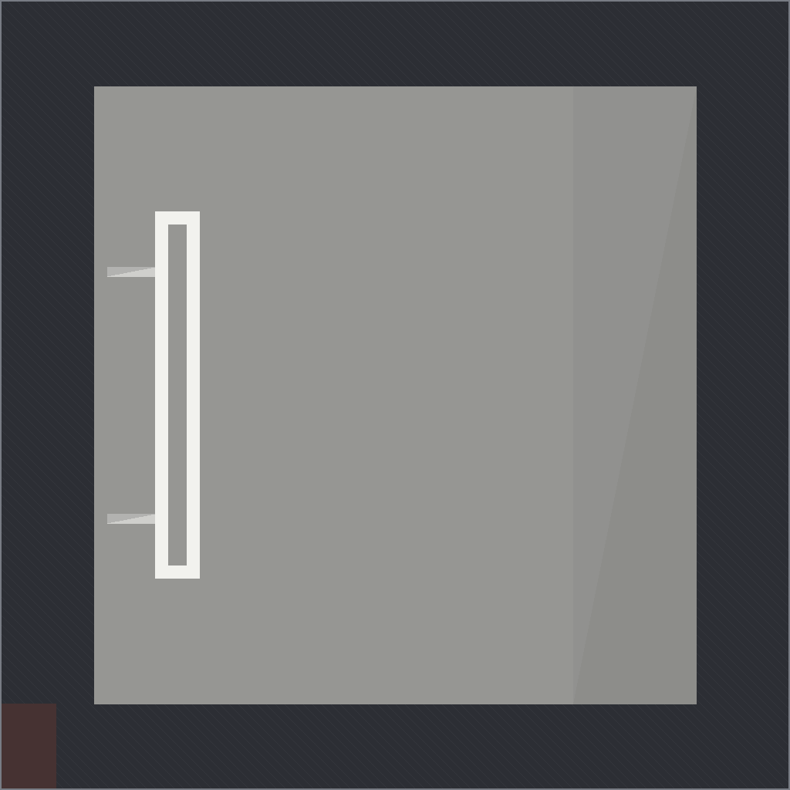
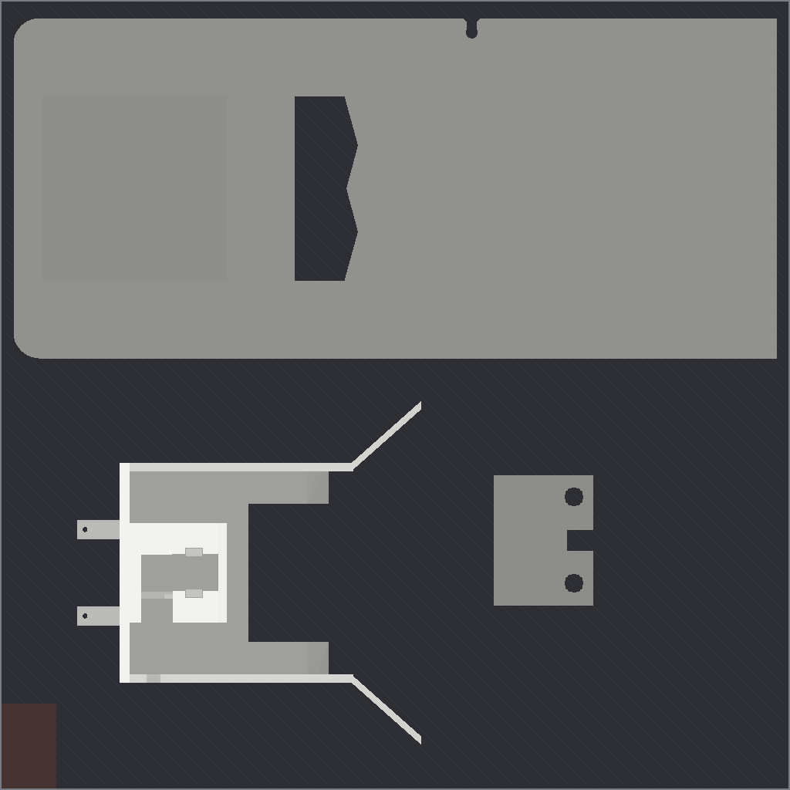
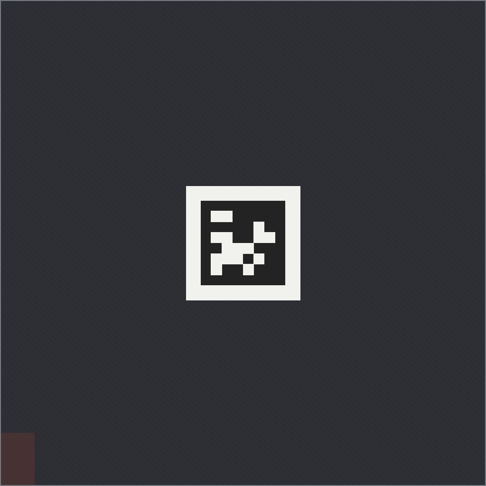

# MicroDock print plates (Bambu Lab P1S)

**[`microdock_P1S.3mf`](microdock_P1S.3mf)** is a Bambu Studio project with everything set: open it, slice, print.

- Three plates, because the base and the board don't fit one 256 × 256 mm plate together.
- Bambu Lab P1S with the 0.4 mm nozzle, the 0.20 mm Standard process and the textured PEI plate.
- Bambu PLA Basic: filament 1 white, filament 2 black (only the tag's base).
- The hood has its supports set: grid supports, on the build plate only.

| Plate | Parts | Bambu Studio's estimate | Plate STL |
|---|---|---|---|
|  | **1:** base | 2 h 9 min, 101 g | [STL](microdock_plate1_base.stl) |
|  | **2:** board on its back, hood upside down, keeper | 2 h 53 min, 128 g (19 min of it supports) | [STL](microdock_plate2_board_hood_keeper.stl) |
|  | **3:** tag, black base with white cells on top | 22 min, 7 g black and 2 g white | [STL](microdock_plate3_tag.stl) |

About 5 h 25 min and 240 g of PLA in all.

## Notes

- **Supports:** the hood prints upside down. Its supports grow from the plate to the hood's top plate and its two pegs.
  The skids, lips and side walls that the duck slides on face up and stay clean, and the ceilings inside the hood
  bridge. Tree supports leave the pegs' flat undersides partly bare, so the project uses grid supports.
- **The tag** changes from black to white at 1.6 mm. With an AMS, the two filaments do it. Without one, set both parts
  of the tag to one filament, add a pause at 1.6 mm on plate 3 and swap to white there.
- **Another build plate:** change the plate type in Bambu Studio; the bed temperature follows it.
- The project was made with Bambu Studio 02.09.01.70, and older versions may warn that it comes from a newer one.
  It has been sliced in Bambu Studio but not printed yet.
- Other slicers: use the plate STLs above (supports as described), or the single parts in [`../stl`](../stl).

## Regenerate

```bash
uv run hardware/microdock/source/plates.py                                     # plate STLs and top views
uv run hardware/microdock/source/bambu_project.py --bambu /path/to/bambu-studio --check   # the project, sliced to check
```

`bambu_project.py` uses Bambu Studio's command-line slicer and its system presets for the P1S, the 0.20 mm Standard
process and Bambu PLA Basic, and `--check` fails on any slicing warning.
